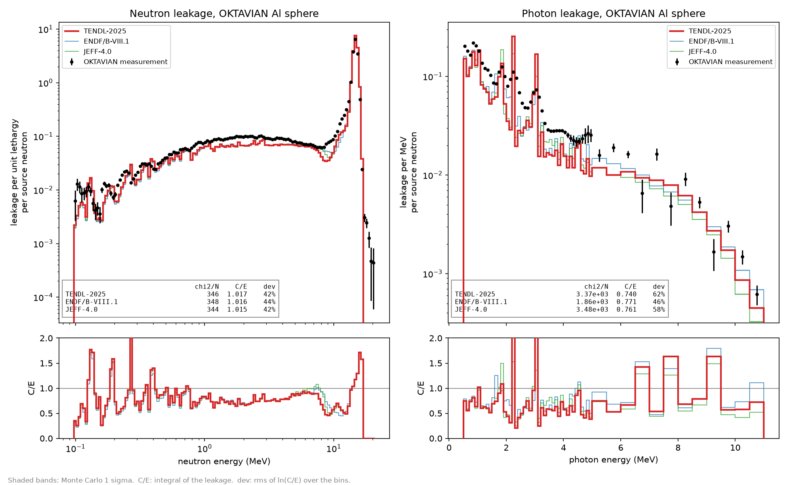

# ENDF to transport to validation

A minimal end-to-end example: one ENDF evaluation goes in, and a comparison
with a measured benchmark experiment comes out.

1. **ENDF in.** The TENDL-2025 evaluation of Al27 (aluminium has a single
   stable isotope). NJOY reconstructs the resonances and Doppler broadens to
   294 K, and `yamc.convert_neutron_transport` writes the Arrow data yamc
   transports with, including TENDL's photon production. The photons are
   transported with the ENDF/B-VIII.1 Al photoatomic and atomic relaxation
   evaluations (`yamc.convert_photon`), because TENDL carries no photoatomic
   data.
2. **Transport.** yamc models the OKTAVIAN aluminium sphere (Osaka
   University): a D-T neutron source at the centre of a 40 cm hollow sphere of
   aluminium powder, built from the experimenters' own MCNP deck. Neutrons and
   the photons they produce are transported, and the spectra leaking out of the
   sphere are tallied.
3. **Validation.** Both leakage spectra are plotted against the measurement,
   with calculated over experimental (C/E) ratios, goodness-of-fit numbers
   and the Monte Carlo statistical error, alongside any reference libraries
   you ask for.



## Install

```bash
python3 -m venv .venv
source .venv/bin/activate
python -m pip install -r requirements.txt
```

Everything is a prebuilt wheel: `yamc` from PyPI, and `njoy2016` from the
wheel index named in `requirements.txt`.

## Run

```bash
python convert_to_arrow.py   # ENDF -> Arrow, once
python run_simulation.py     # transport, comparison, results/oktavian_al.png
```

The plot above is

```bash
python run_simulation.py --compare endf-b8.1 jeff-4.0
```

The first case, the evaluation under test, is drawn thick and on top; the
references are fainter lines behind it. Each case is 10 million source
neutrons, about 5 seconds.

## Testing your own evaluation

Pass any ENDF-6 neutron evaluation of Al27, such as one freshly produced by
TALYS, and the reference libraries to compare it against:

```bash
python run_simulation.py \
    --neutron-file path/to/my-Al27.endf --label "new evaluation" \
    --compare tendl-2025 endf-b8.1 jeff-4.0 jendl-5.0 fendl-3.2d
```

* `--label` is required with it: it is the name shown in the legend, the
  table and the JSON. The file itself is recorded there by path and sha256.
* The file can have any name. It is processed with NJOY (294 K) on the first
  run, and the conversion is cached by the file's sha256, so a changed file is
  converted again and an unchanged one is not.
* `--compare` takes yamc library keywords: `tendl-2025`, `tendl-2017`,
  `endf-b8.1`, `jeff-4.0`, `jendl-5.0` and `fendl-3.2d`. yamc downloads the
  processed Al27 data for each on first use.
* Every case uses the same geometry, source and ENDF/B-VIII.1 photon
  interaction data, so the differences between the curves come from the
  neutron evaluation alone.
* `--particles` sets the histories per case, and `--output-dir` where the
  results go.

Besides the plot, each run writes `results/oktavian_al.json`, for another
program to read. For every case it holds:
* where the data came from: the file path and its sha256, or the library
  keyword;
* the neutron and photon leakage spectra and their Monte Carlo errors;
* C/E per bin;
* chi2/N, the integral C/E, the bin deviation, and the median and largest
  Monte Carlo error.

It also holds the measured spectra with their bin edges and units, and the
yamc version.

## Where the data comes from

No third-party data is stored in this repository. `convert_to_arrow.py` looks
for each ENDF evaluation in `nuclear_data/` and downloads only the files that
are missing, about 6 MB in all, checking each against a pinned sha256:

* `n-Al027.tendl`: **TENDL-2025** neutron evaluation of Al27 (CC-BY-4.0,
  A.J. Koning et al.), downloaded on its own from `tendl.imperial.ac.uk`
  (3.9 MB).
* `photoat-013_Al_000.endf` and `atom-013_Al_000.endf`: **ENDF/B-VIII.1**
  photoatomic and atomic relaxation evaluations of Al from the NNDC. The NNDC
  only publishes whole sublibrary archives, so the archive is streamed and the
  download stops once the Al file has been read (1.8 MB and 20 kB).

Once downloaded they are ordinary local files. If you already have copies,
point the script at them to skip the download; the directory is searched
recursively by file name. Every file, local or downloaded, must match its
pinned sha256, so the default case is always exactly TENDL-2025. To test a
different evaluation, use `--neutron-file` (below).

```bash
python convert_to_arrow.py --endf-dir ~/nuclear_data
```

The measurements are downloaded by `run_simulation.py` into `downloads/` and
checked against pinned sha256 values:

* **OKTAVIAN measurements**, JAERI-M 94-014 (Maekawa et al., 1994, chapters 3
  and 4), from the FENDL-2 benchmark sublibrary as mirrored by the OECD/NEA.
  The files are scanned report pages. The script undoes the OCR substitutions
  (`O` for `0`, `l` for `1`), and one source spectrum entry that is
  unambiguously a dropped digit is corrected, with the reasoning given in
  `run_simulation.py`.

## Goodness of fit

Each panel of the plot, the script's output and the JSON give these, per
library:

* **chi2/N**: the mean over bins of ((C - E) / sigma)^2, with the experimental
  and Monte Carlo uncertainties added in quadrature. 1 means agreement within
  the quoted errors. The measured neutron errors are counting statistics only
  (a fraction of a percent near the peak), and neither spectrum is folded with
  the detector's energy resolution, so expect values well above 1 even for a
  good evaluation. It is most useful for comparing two libraries on the same
  model.
* **integral C/E**: total calculated over total measured leakage.
* **bin deviation**: the root mean square of ln(C/E) over the bins, as a
  percentage.
* **Monte Carlo error**: the shaded band on each curve is +/- 1 sigma. The
  script warns when any bin is above 5% and says to raise `--particles`.

## What the comparison includes, and what it leaves out

To keep this to one isotope, the model leaves out the 0.2 cm SUS-304 vessel
walls. Those walls would bring in Cr, Fe and Ni.

| | neutrons 0.1-20 MeV | neutrons 1-10 MeV | photons 0.5-11 MeV |
|---|---|---|---|
| this example (Al27 only) | 1.02 | 0.76 | 0.74 |
| with the steel walls added | 1.02 | 0.87 | 0.85 |

(C/E of the integrated leakage.) The walls matter, mostly through extra
inelastic scattering and gamma production, so the low photon and low neutron
continuum here are largely the simplified model, not TENDL. Running the same
model with ENDF/B-VIII.1 Al27 instead gives 1.02, 0.78 and 0.77. The walls
affect every library equally, so they do not change how the libraries rank
against each other.

Also worth knowing:

* The tritium target's own gamma rays (0.0862 per source neutron, Table 3.1 of
  the report) reach the detector too. They are transported through the sphere
  in a second, photon-only run and added to every library's photon spectrum.
* The gamma measurement counted photons arriving within 69 ns of the source
  pulse. yamc runs to steady state, so slow capture gammas are included.
* yamc has no surface current tally, so leakage is tallied as track-length
  flux in a void shell around the sphere, which is exact to 1e-4 here (see
  the docstring of `run_simulation.py`).

## Extending it

See issue #1 for other OKTAVIAN spheres and other benchmarks.
