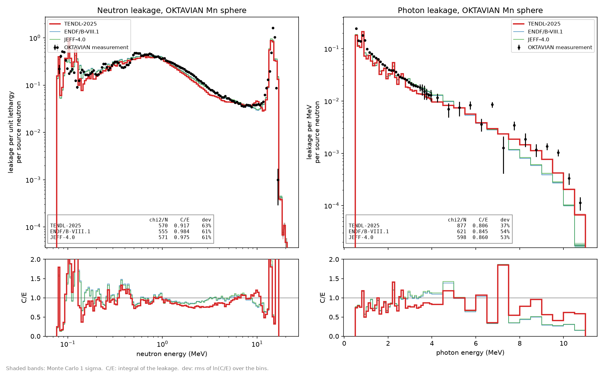

# ENDF to transport to validation

A minimal end-to-end example: an ENDF evaluation goes in, and a comparison
with a measured benchmark experiment comes out.

1. **ENDF in.** The TENDL-2025 evaluation of the sample nuclide. NJOY
   reconstructs the resonances and Doppler broadens to 294 K, and
   `yamc.convert_neutron_transport` writes the Arrow data yamc transports
   with, including TENDL's photon production.
2. **Transport.** yamc models an OKTAVIAN sphere (Osaka University): a D-T
   neutron source at the centre of a sphere of the sample, held in its steel
   vessel, as described in the experiment report. Neutrons and the photons
   they produce are transported, and the spectra leaking out are tallied.
3. **Validation.** Both leakage spectra are plotted against the measurement,
   with calculated over experimental (C/E) ratios, goodness-of-fit numbers
   and the Monte Carlo statistical error, alongside any reference libraries
   you ask for.


## The spheres

| `--case` | sample | vessel | measured |
|---|---|---|---|
| `al` (default) | Al27, 1.22 g/cm3 | 40 cm Type-II, SUS-304, 0.2 cm walls | neutron and photon leakage |
| `mn` | Mn55, 4.37 g/cm3 | 61 cm Type-I, SS-41, 0.5 cm walls | neutron and photon leakage |

Both samples are a single isotope, so one evaluation is tested at a time. The
Al geometry is the experimenters' own MCNP deck, surface for surface; the Mn
geometry follows the report's vessel description, and the sample masses in
the report agree with both to within 3%.



The Co and Nb spheres are also single isotopes but are left out for now (see
issue #1): the Co measurement reports more leaking neutrons than its physics
allows, and for Nb every library misses by the same amount, which points at
the vessel model rather than the nuclear data.

## Install

```bash
python3 -m venv .venv
source .venv/bin/activate
python -m pip install -r requirements.txt
```

Everything is a prebuilt wheel: `yamc` from PyPI, and `njoy2016` from the
wheel index named in `requirements.txt`.

## Run

```bash
python convert_to_arrow.py                   # ENDF -> Arrow, once (about 40 s)
python run_simulation.py                     # the Al sphere
python run_simulation.py --case mn           # the Mn sphere
```

The plots above are

```bash
python run_simulation.py --case al --compare endf-b8.1 jeff-4.0
python run_simulation.py --case mn --compare endf-b8.1 jeff-4.0
```

The evaluation under test is drawn thick and on top; the references are
fainter lines behind it. Each library is 10 million source neutrons, a few
seconds for Al and longer for the thicker Mn sphere.

## Testing your own evaluation

Pass any ENDF-6 neutron evaluation of the sample nuclide, such as one freshly
produced by TALYS, and the reference libraries to compare it against:

```bash
python run_simulation.py --case al \
    --neutron-file path/to/my-Al27.endf --label "new evaluation" \
    --compare tendl-2025 endf-b8.1 jeff-4.0 jendl-5.0 fendl-3.2d
```

* `--label` is required with it: it is the name shown in the legend, the
  table and the JSON. The file itself is recorded there by path and sha256.
* The file can have any name. It is processed with NJOY (294 K) on the first
  run, and the conversion is cached by the file's sha256, so a changed file is
  converted again and an unchanged one is not. An evaluation of the wrong
  nuclide for the sphere is refused.
* `--compare` takes yamc library keywords: `tendl-2025`, `tendl-2017`,
  `endf-b8.1`, `jeff-4.0`, `jendl-5.0` and `fendl-3.2d`. yamc downloads the
  processed data for each on first use.
* Only the sample's neutron data changes between libraries. The vessel's
  neutron data (TENDL-2025) and every element's photon interaction data
  (ENDF/B-VIII.1) are the same for all of them, so the differences between
  the curves come from the sample's evaluation alone.
* `--particles` sets the histories per library, and `--output-dir` where the
  results go.

Besides the plot, each run writes `results/oktavian_<case>.json`, for another
program to read. For every library it holds:
* where the data came from: the file path and its sha256, or the library
  keyword;
* the neutron and photon leakage spectra and their Monte Carlo errors;
* C/E per bin;
* chi2/N, the integral C/E, the bin deviation, and the median and largest
  Monte Carlo error.

It also holds the measured spectra with their bin edges and units, the
sphere's geometry and vessel steel, and the yamc version.

## Where the data comes from

No third-party data is stored in this repository.

* **Sample evaluations**: `convert_to_arrow.py` looks for `n-Al027.tendl` and
  `n-Mn055.tendl` (TENDL-2025, CC-BY-4.0, A.J. Koning et al.) in
  `nuclear_data/`, and downloads any that are missing from
  `tendl.imperial.ac.uk`, about 4 MB each. Every file, local or downloaded,
  must match its pinned sha256, so the default case is always exactly
  TENDL-2025. If you already have copies, point the script at them to skip
  the download (searched recursively by file name):
  `python convert_to_arrow.py --endf-dir ~/nuclear_data`.
* **Vessel and photon data**: not what the benchmark tests, so loaded already
  processed by yamc keyword: the steel's neutron data from TENDL-2025, and
  photon interaction data from ENDF/B-VIII.1, since TENDL publishes no
  photoatomic data.
* **Measurements, geometry and source**: JAERI-M 94-014 (Maekawa et al.,
  1994, chapters 3 and 4), from the FENDL-2 benchmark sublibrary as mirrored
  by the OECD/NEA, downloaded by `run_simulation.py` into `downloads/` and
  checked against pinned sha256 values. The files are scanned report pages.
  The script undoes the OCR substitutions that are safe to undo, repairs lost
  exponent signs only where the bin edges must join up, and leaves out (and
  reports) any value it cannot read safely rather than guessing it.

## Goodness of fit

Each panel of the plot, the script's output and the JSON give these, per
library:

* **chi2/N**: the mean over bins of ((C - E) / sigma)^2, with the experimental
  and Monte Carlo uncertainties added in quadrature. 1 means agreement within
  the quoted errors. The measured neutron errors are counting statistics only
  (a fraction of a percent near the peak), and neither spectrum is folded with
  the detector's energy resolution, so expect values well above 1 even for a
  good evaluation. It is most useful for comparing libraries on the same
  model.
* **integral C/E**: total calculated over total measured leakage.
* **bin deviation**: the root mean square of ln(C/E) over the bins, as a
  percentage.
* **Monte Carlo error**: the shaded band on each curve is +/- 1 sigma. The
  script warns when any bin is above 5% and says to raise `--particles`.

## Known differences from the experiment

* The tritium target's own gamma rays (0.0862 per source neutron, Table 3.1 of
  the report) reach the detector too. They are transported through the sphere
  in a separate photon-only run and added to every library's photon spectrum.
* The gamma measurement counted photons arriving within about 65 ns of the
  source pulse. yamc runs to steady state, so slow capture gammas are
  included.
* The Mn vessel's 5.1 cm beam hole is modelled as empty, since the report does
  not give the thickness of its tube.
* yamc has no surface current tally, so leakage is tallied as track-length
  flux in a void shell around the sphere, which is exact to 1e-4 here (see
  the docstring of `run_simulation.py`).

## Extending it

See issue #1 for other OKTAVIAN spheres and other benchmarks.
